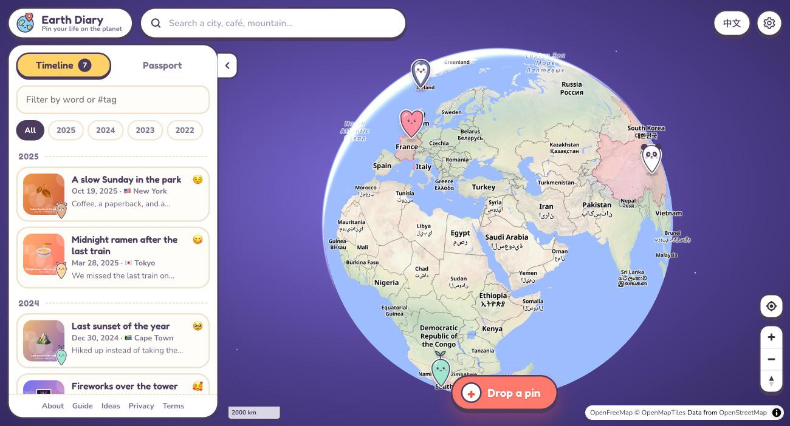
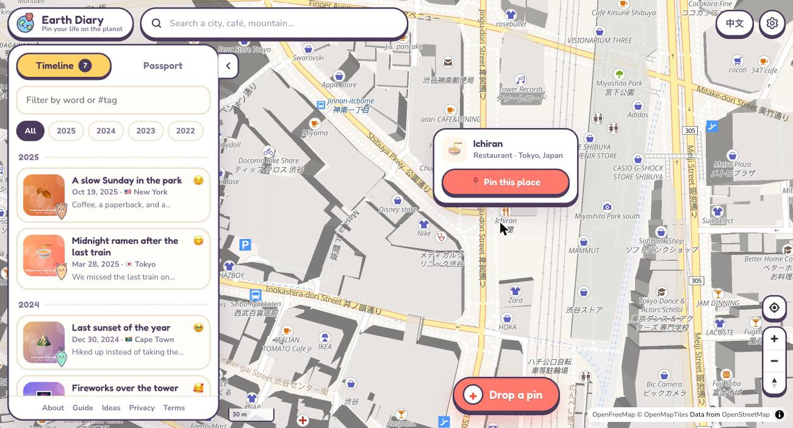
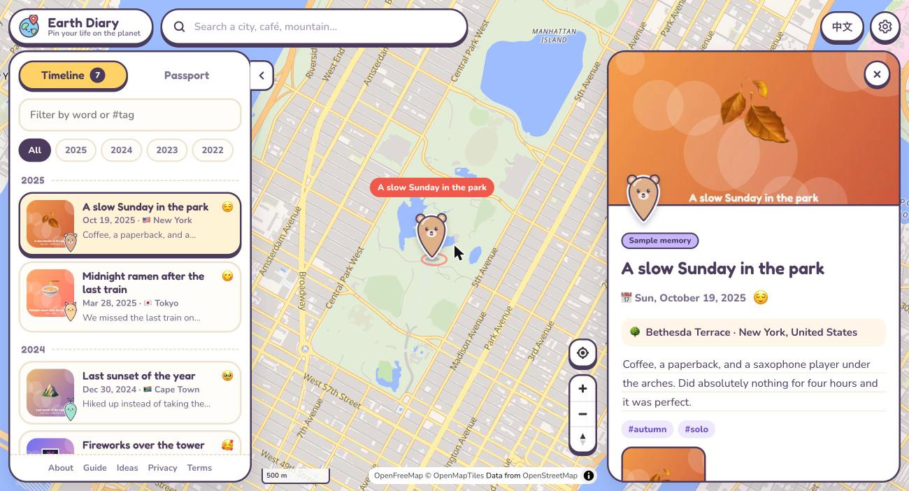
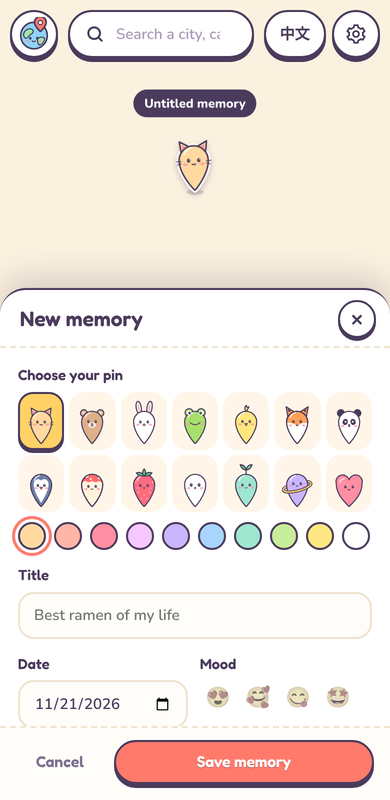

# Earth Diary 🌍📍

**Pin your life on the planet.** A world map where every pin holds a diary entry, photos and videos — down to a single restaurant.

**Live site → https://emmazhao422.github.io/earth-diary/**

| Your globe | Down to a single restaurant |
| --- | --- |
|  |  |
| **A memory** | **On a phone** |
|  |  |

Screenshots are from the live site on 2026-11-21 with the built-in sample pins.

## What it does

- **Detailed world map** — vector tiles built from OpenStreetMap, shown as a 3D globe when zoomed out and street-level detail when zoomed in. Cafés, restaurants, shops, parks and peaks are tappable.
- **Cute animated pins** — 14 original characters × 10 colors that bob, blink, wiggle and bounce when dropped.
- **A memory inside every pin** — title, date, mood, diary text, tags, any number of photos and videos, with a full-screen viewer.
- **Five ways to pin** — tap the map, tap a place name, search (places or coordinates), right-click / long-press, or start from a photo: photos that remember where they were taken place themselves, and a batch from several places becomes one pin per place and day.
- **Timeline** — every memory by date, filter by word, `#tag` or year, plus “On this day”.
- **Passport** — countries, cities, continents, photos, videos and journey length; visited countries light up; journey replay; shareable passport card (PNG).
- **Private** — no account, no server. Everything is stored in the browser (IndexedDB) on the user's device.
- **Backup** — export / import everything as one `.zip`.
- **English + 中文**, mobile layout, installable (PWA), works offline for the app shell.
- **Monetization built in** — ad slots, affiliate links, tip link and analytics are all switched on from one config file.

## Project layout

```
index.html              the app
about / guide / ideas / privacy / terms .html   content pages
assets/js/config.js     ← the one file to edit for ads, affiliate links, tips, analytics
assets/js/app.js        map, pins, editor, timeline, passport, settings
assets/js/pins.js       the pin characters (inline SVG)
assets/js/db.js         IndexedDB storage      assets/js/media.js   photo/video thumbnails
assets/js/geo.js        search + reverse geocoding (Photon), country helpers
assets/js/backup.js     zip export/import      assets/js/ads.js     ads, consent, affiliate links
assets/js/sharecard.js  passport card image    assets/js/samples.js sample pins
assets/data/countries.json   simplified country outlines (Natural Earth via world-atlas)
assets/vendor/          MapLibre GL JS, fflate (with licenses)
sw.js, manifest.webmanifest   offline + install
docs/MONETIZATION.md    how the site makes money and what is left to switch on (中文)
tests/e2e.py            end-to-end browser test
```

There is **no build step**. The repository root is the website; GitHub Pages serves the `main` branch as-is.

## Run locally

```bash
python3 -m http.server 8765
# open http://localhost:8765/
```

Useful URL switches: `?ads=preview` outlines every ad slot, `?style=blank` runs without the tile server.

## Tests

```bash
pip install playwright pillow && playwright install chromium
python3 -m http.server 8765 &
python3 tests/e2e.py            # uses tests/media, screenshots go to /tmp/shots
```

The test creates, edits and deletes memories, uploads photos and a video, reloads to check persistence, exports and re-imports a backup, and checks the passport, share card, language switch, ad preview and mobile layout.

## Data sources and credits

| Part | Source | Notes |
| --- | --- | --- |
| Map rendering | [MapLibre GL JS](https://maplibre.org) (BSD-3-Clause) | vendored in `assets/vendor` |
| Map tiles | [OpenFreeMap](https://openfreemap.org) | free public instance, no API key; provided as-is |
| Map data | © [OpenStreetMap](https://www.openstreetmap.org/copyright) contributors, [OpenMapTiles](https://www.openmaptiles.org/) schema | attribution is shown on the map |
| Place search / reverse geocoding | [Photon](https://photon.komoot.io) by komoot | free public API under fair use; requests are debounced and cached |
| Country outlines | [world-atlas](https://github.com/topojson/world-atlas) (Natural Earth, public domain) | simplified |
| Zip | [fflate](https://github.com/101arrowz/fflate) (MIT) | |
| Fonts | Fredoka, Nunito (SIL Open Font License) | self-hosted |

The free tile and search services have no uptime guarantee. If traffic grows, self-host tiles (OpenFreeMap publishes how) or switch `map.styles` / `map.geocoder` in `assets/js/config.js` to a paid provider.

## License

MIT for the code in this repository. Third-party components keep their own licenses (included next to them).
